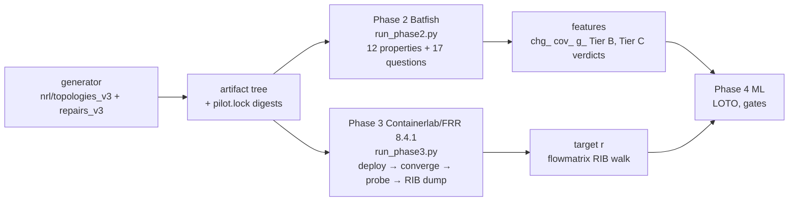
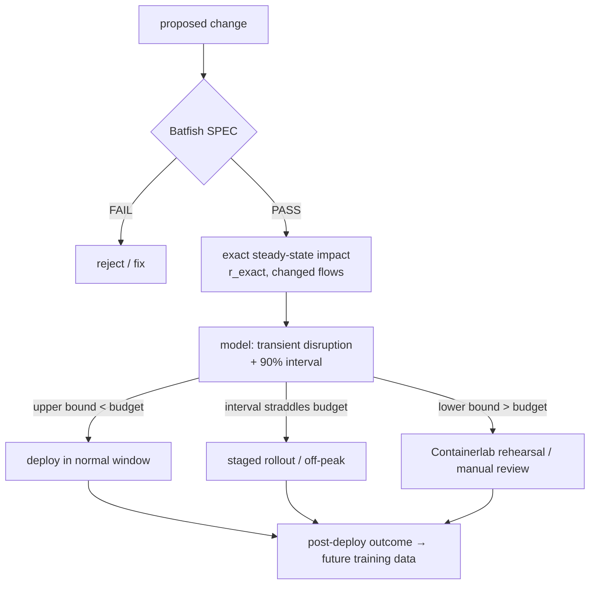

# V4 pivot and expansion plan — Batfish + Containerlab + ML

**Date:** 2026-09-14 · **Status:** planning document. It is **not** a pre-registration and
it changes no frozen artifact. Nothing expensive has been run.

**Evidence labels used throughout**

| label | meaning |
|---|---|
| VERIFIED-REPO | read or recomputed from this repository in this session |
| MEASURED | taken from recorded Phase 2 / Phase 3 execution records |
| EXPLORATORY | computed after the v3 gates were seen; cannot change any v3 verdict |
| VERIFIED-WEB | read from the named official page or repository |
| FORECAST | a planning estimate with stated assumptions, not a result |
| NEEDS VERIFICATION | could not be verified; must be checked before it is relied on |

Scripts behind every number: `analysis/v3_claude_final/*` (gates, audit) and
`analysis/v3_expansion_planning/*` (this document's exploratory analyses).

---

## 1. Executive summary

1. **The v3 target is computed exactly by Batfish itself.** Walking each candidate's
   saved Batfish main RIB (`phase2/raw/<C>/questions/routes.json`) reproduces the
   emulator's forwarding path for **26,738 of 26,738 flows** on **151 of 151**
   candidates. r from Batfish alone equals measured r on **115 of 115** candidates
   whose topology has a no-op baseline, and on 151 of 151 against the golden run.
   Batfish needs a median **7.7 s** per candidate (MEASURED), and its `routes`
   question takes about 0.12 s. *VERIFIED-REPO.*
2. **The learned model therefore approximates a quantity that is already free and exact
   before deployment.** Tier C LOTO R² 0.848 and Tier B 0.744 are strictly dominated by
   R² 1.000 at negligible cost. A zero-parameter lookup on mechanism × one Batfish
   verdict (P06) reaches **0.794**. Tier B, the learned claim, is **below** that lookup
   (−0.050, CI [−0.168, +0.062]). *EXPLORATORY.*
3. **More data will not fix this.** The problem is not variance. The question asked
   has a closed-form answer. Scaling the v3 corpus would narrow confidence intervals
   around a number nobody needs to learn.
4. **Change the research question.** Two quantities remain that Batfish's
   converged-state model cannot compute, and both are operationally real: the
   **transient disruption** while a change converges, and **traffic-dependent
   performance impact** (Batfish has no capacity or traffic model). Neither is
   yet shown to be measurable, non-trivial, or not reducible to an analytic baseline.
5. **Recommendation: a gated plan, not a 30–40 h run.** Close v3 honestly (a day of
   analysis). Run a pre-registered transient-disruption pilot of about 20 changes × 5
   replicates, 3–5 h on one laptop, with kill criteria. Only if it passes, freeze v4
   and launch the distributed corpus in §38. If it fails, publish the deterministic
   specification-completeness result (§39) at Batfish-only scale. That paper needs no
   Containerlab scale-out.
6. **SWECHA Corpus is a data-collection platform.** Its volunteer compute runs a single
   workload, ASR transcription, over locked records. It has no generic job type, no
   sandbox and no result verification, so it should not schedule Containerlab jobs.
   The recommended distributed design is GitLab CI with self-managed project runners
   on friends' WSL machines, plus content-addressed result bundles. *VERIFIED-WEB where stated.*

---

## 2. Research question

**Original thesis (docs/PROJECT-HANDOFF.md):** ML systems that act on networks do not know
when they are wrong. Operational form: how often does a change that passes formal
verification still cause harm, and can that residual risk be predicted and calibrated?

**v3 form (docs/ANALYSIS-PLAN-V3.md §0, §3):** predict the blast radius
r = (broken + rerouted flows) / golden-carried flows of a SPEC-passing change from
pre-deployment evidence.

**What the evidence now says about each form**

| form | status | evidence |
|---|---|---|
| binary P(harm \| PASS) (v1/v2) | deterministic, recoverable from generator variables | Gate 0: 0/40 outcome flips under churn; repair_class AUC 0.975 |
| blast radius r (v3) | deterministic and computed exactly by Batfish | 26,738/26,738 flows identical, 151/151 r exact |
| transient disruption during convergence | **untested** | pipeline measures cold-boot convergence at 5 s polls only |
| traffic/performance impact of reroutes | **untested** | no traffic or capacity model in the pipeline |

---

## 3. Research history — one table

| date | commit / tag | event | status |
|---|---|---|---|
| 2026-08-25 | `frozen-defs-v1.1.0` | harm definition v1.1.0 frozen | frozen |
| 2026-09-02 | `7b8f0fe` | pilot-v1 complete (1 topology, 50 candidates) | exploratory pilot |
| 2026-09-02 | `044b70d` | ANALYSIS-PLAN.md frozen, harm v1.2.0 (transient) pre-registered | frozen |
| 2026-09-03 | `75998e3` | 20-topology design, pilot-v2 corpus (1,479 candidates) | built |
| 2026-09-04 | `ba2afcf` | Stage 1 report: 6/7 GO criteria, shortcut AUC 0.999 | confirmatory for apparatus |
| 2026-09-11 | `frozen-stage3-n301` | Stage 3 partial, 301 PASS candidates | frozen data |
| 2026-09-11 | `analysis/interim` | v2 learned arm verdict: **BAD — SHORTCUT-ONLY** | exploratory verdict under frozen §14.2 |
| 2026-09-11 | `analysis/gate0` | Gate 0: 40 candidates, 0 intermediate → **NO-GO** (label deterministic) | pre-registered gate |
| 2026-09-12 | `048af66…2282bda` | flow-risk metric, zero-inflation, severity model 18/30 → 30/30 | exploratory design |
| 2026-09-12 | `65505a2` `frozen-v3-plan-20260912` | **v3 plan frozen** before any candidate | frozen |
| 2026-09-12 | `ff432ca` `built-v3-corpus-n151` | v3 corpus built: 151 candidates, 12 topologies | frozen data |
| 2026-09-12 | `deb5eea` | Amendment 12.1 | amendment |
| 2026-09-12 | `b5e53df` `v3-gate-GO-20260912` | Amendment 12.2 + spike_v3 Batfish gate GO | amendment |
| 2026-09-12 | `f3c9035` `v3-phase2-complete` | Phase 2: 151/151 SPEC-PASS, verifier 29/29 | confirmatory measurement |
| 2026-09-13 | Phase 3 | 5 batches, 101 SAFE / 48 HARMFUL / 2 UNDETERMINED | confirmatory measurement |
| 2026-09-14 | `1c8d9c1` | Phase 3 outputs + Copilot audit folders committed | record |
| 2026-09-14 | `a38d258` | Amendment 12.4 (calibration), post-result | disclosed deviation |
| 2026-09-14 | `6efbdb0` | final gates: Tier B GO under 12.4, Tier C NOT GO | confirmatory under amendment |
| 2026-09-14 | this document | Batfish computes r exactly; pivot proposed | exploratory |

---

## 4. v1 — pilot-v1

- One topology (T2-derived), 50 candidates of which 41 are distinct networks
  (ARCHITECTURE.md §8), 9 fault families. Outcomes: 38 HARMFUL, 12 SAFE. *VERIFIED-REPO.*
- Established the apparatus: same-artifact guarantee, two digests, construct capability
  table, and the F10 lesson that byte-identity is necessary but not sufficient.
- **Claims retained:** the Batfish ↔ FRR artifact chain works for the constructs in §12.
- **Claims rejected:** none. Too small for any statistical claim.

## 5. v2 — pilot-v2 and the residual-risk arm

- 20 topologies, 200 incidents, **1,479** candidates, 10 fault families, repair classes
  correct 420 / incomplete 598 / regressive 461. *VERIFIED-REPO.*
- Stage 3 partial: 301 PASS candidates run; 219 SAFE, 79 HARMFUL, 2 EXECUTION_FAILED,
  1 NO_CONVERGENCE.
- **Rejected claim — "a learned residual-risk model":** `repair_class` recoverable at worst-case
  AUC 0.975 on the PASS population, and `fault_family` at 0.9975 (interim/VERDICT.md).
- **Rejected claim — "irreducible risk exists":** Gate 0 randomised a transit-link flap
  during convergence. 0 of 40 candidates changed outcome, so the label is a function of
  the configuration and "calibrated P(harm)" is a category error (env_randomize.py docstring).
- **Retained:** the apparatus, the defect log, and the finding that the binary label is deterministic.

## 6. v3 — design and freeze

- Target changed to the continuous blast radius r, reconstructed from RIBs over every
  ordered endpoint pair.
- Analytic severity model `nrl/severity.Fabric`, validated 36/36 against FRR after the
  ECMP tie-break fix (18/30 → 30/30).
- 20 ECMP-free topology designs (`nrl/topologies_v3.py`); **12 primary** used, **8 held-out
  never built**.
- Mechanisms: OSPF cost ×20 on both ends, and router-loopback /32 static blackhole.
  `shutdown` and `exact` pre-registered as an auxiliary arm and never built.
- Candidates selected at severity quantiles (0.05, 0.25, 0.5, 0.75, 0.95) of the
  **predicted** r, SPEC-gate enforced, repair ids relabelled by target, 64 duplicate
  configs dropped. *VERIFIED-REPO (manifest).*
- §8 GO needs four criteria: LOTO R² ≥ 0.40 with CI excluding 0; within-mechanism gain
  ≥ 0.15 on both mechanisms; calibration; and a shortcut gap > 0.05.

## 7. v3 amendments

| # | commit | what changed | why | effect on claims |
|---|---|---|---|---|
| 12.1 | `deb5eea` | corpus recorded as 151 (not 215); repair_class voided; degenerate secondary split replaced by LOMO (2 directions) + grouped 4-fold | incident identity = topology identity; generator made repair_class a relabelling | secondary split now tests something |
| 12.2 | `b5e53df` | `spike_v3.py`: CHECK 6 substituted with candidate-level evidence, CHECK 5 N/A | two spike checks need fault snapshots; v3 has no faults | Phase 2 unblocked, underlying verdict preserved |
| 12.3 | (plan text) | blackhole rationale corrected: 72/72 target loopback /32; P03/P04 PASS on all; P11 fails 9/72 | §1.2's mechanism was wrong | conclusion survives, route differs |
| 12.4 | `a38d258` | calibration protocol replaced, **post-result**; literal §8.3 recorded FAILED | frozen calibrators reject continuous y; flow-count binomial interval has no sampling model | Tier B GO under 12.4, Tier C NOT GO |

## 8. Phases and audits — which claims survive

| claim | source | verdict | evidence |
|---|---|---|---|
| verifier 40/40, 180 runs, 101/48/2, 0 terminal failures | Copilot | **confirmed** | `verify_phase3.py` rerun |
| measured r: 91 distinct, mean 0.116245, median 0.058333, max 0.447619 | Copilot | **confirmed** three ways | `reproduce_r.py` |
| LOTO R² 0.848, CI [0.780, 0.917] | Copilot | **confirmed** (CI [0.776, 0.915] with seed 0) | final_gates_12_4 |
| shortcut-only R² 0.313, gap 0.535 | Copilot | **wrong feature set**; plan-worded shortcut 0.499 | audit_ml_calibration |
| nested calibration 0/4, slope 0.691 | Copilot | reproduced exactly; caused by calibrator refit mismatch plus a pseudo-replicated interval | audit §4 |
| first-pass calibration 4/4 | Copilot | used a ±0.05 band not in §8.3 | audit §4 |
| "learned headline 0.848" | Copilot | Tier C must be reported separately (§4); learned headline 0.744 | final_gates_12_4 |
| "result exists only at 11 training topologies" | Claude audit | **corrected here**: HGB-specific artefact (min_samples_leaf=20); RF reaches 0.773 at 4 topologies | §36 |
| "ML adds information beyond Batfish" | implicit | **rejected**: Batfish computes r exactly | §17 |

---

## 9. Current architecture



Invariants retained for v4: same-artifact staging with hash verification, two digests,
build scope vs runtime scope, frozen property suite, and structured JSON per run.

## 10. Current corpus (v3)

| item | value |
|---|---|
| candidates | 151 (cost 79, blackhole 72) |
| topologies used | 12 of 20 designed |
| class × mechanism | cost: correct 65, incomplete 8, regressive 6 · blackhole: regressive 48, incomplete 24 |
| repair ids | RC-reroute 51, RR-damage 35, RI-partial 32, RR-minor 15, RC-noop 14, RR-shift 4 |
| duplicates dropped | 64 |
| Phase 2 | 151/151 SPEC-PASS |
| Phase 3 | 101 SAFE / 48 HARMFUL / 2 UNDETERMINED (binary v1.1.0) |
| storage | runs 189 MB (≈1.0 MB/lab), phase2 65 MB (≈0.43 MB/candidate), artifacts 22 MB |

## 11. Current topologies

20 designs in `nrl/topologies_v3.py`, all two-site with a primary and a backup path.
The 12 primary designs (routers): t03_dual8 (8), t05_ring6 (6), t06_mesh6 (6),
t09_twin6 (6), t13_bowtie7 (7), t14_ladder8 (8), t15_campus12 (12), t16_pop14 (14),
t17_metro13 (13), t18_grid12 (12), t19_dualcore16 (16), t20_leafspine12 (12).
Held out and never built: t01_chain4, t02_wan6, t04_star5, t07_tier7, t08_chain8,
t10_deep9, t11_branch6, t12_campus8.

**Weakness:** these are hand-designed variants of one template, 6–16 routers, OSPF area 0,
with ECMP deliberately removed by 18 cost nudges. There is no family structure, so a
leave-one-family-out test is impossible, and no real (Topology Zoo) graph is used.

## 12. Current configuration mechanisms and construct support

| construct | Batfish | FRR/Containerlab | used in |
|---|---|---|---|
| `ip ospf cost` | yes (164/164) | yes | v2 faults, v3 primary |
| static `blackhole` | yes (discard, AD 1) | yes | v2 faults, v3 primary |
| static next-hop | yes | yes | v2 faults |
| interface `shutdown` | yes | yes | v2 faults; v3 aux, never built (fails P08 100%) |
| `passive-interface` | yes | yes | v2 faults |
| `ip ospf area` | yes | yes | v2 faults |
| `ip ospf network point-to-point` | yes | yes | all |
| `ip ospf network broadcast` | **no** (parse warning) | yes | excluded |
| FRR `access-list`, OSPF `distribute-list` | **no, silently** | yes | excluded; divergence risk |
| BGP | unverified; not rendered (`nrl/topology.py`: OSPF only) | yes | never |
| packet ACLs | not in FRR concatenated format | iptables | excluded |

Source: docs/ARCHITECTURE.md §1d, §3, §4 (VERIFIED-REPO).

## 13. Current candidate generation

`nrl/repairs_v3.catalogue()` enumerates cost and blackhole interventions per topology.
`severity.Fabric` predicts r for each, `_pick()` selects at predicted-r quantiles,
`_relabel()` reassigns repair ids by target, and `spec_pass()` enforces the SPEC gate.

**Consequences:**
- The distribution is designed on the analytic prediction.
- Mechanism determines the flow type (blackhole → 100% broken, cost → 100% rerouted).
- P06 separates cost candidates into two regimes.

## 14. Batfish pipeline — measured cost

| stage | median | min | max | source |
|---|---|---|---|---|
| full candidate (init + 17 questions + 12 properties) | **7.7 s** | 5.5 s | 9.8 s | batfish_summary.run_seconds, n=151 |
| 12-property suite | 4.3 s (p90 5.6, p95 5.9) | 2.5 s | 6.5 s | batfish_properties.seconds |
| one question | ≈ 0.115 s (layer3Edges 0.27 s) | — | — | questions_index |

Snapshot initialisation and first dataplane computation are not recorded separately.
They sit inside `run_seconds` minus question time (≈ 5 s): **NEEDS VERIFICATION** by a
dedicated benchmark.

## 15. Containerlab pipeline — measured cost

| stage | median | p90 | p95 | min | max |
|---|---|---|---|---|---|
| complete lab, start-to-start | **84 s** | 90 | 92 | 60 | 695* |
| deploy (clab log span) | 4 s | 5 | 5 | 2 | 8 |
| convergence (policy floor 45 s) | 48.5 s | 50.3 | 50.4 | 47.3 | 50.6 |
| property probes (5 pings each) | 24.3 s | 24.6 | 25.3 | 0 | 25.3 |
| destroy | 2 s | 3 | 3 | 0 | 3 |

\* The outlier includes a retry or batch boundary. 184 intervals under 1,200 s were used.
Median lab time by container count: 9 → 81 s, 11 → 84 s, 15 → 85 s, 17 → 88 s, 19 → 90.5 s.
First-attempt LAB_INVALID: 6/186 (3.2%), terminal 0. Host: WSL2, 16 vCPU, 7 GB RAM,
labs run sequentially. *MEASURED.*

**The main lesson:** 87% of lab time is protocol policy (45 s settle floor + 5-ping probes),
not compute. Concurrency and protocol design matter more than faster hardware.

## 16. Current target

r = (broken + rerouted) / golden-carried flows, over all ordered endpoint pairs
(72–342 flows per topology). 91 distinct values, mean 0.116, median 0.058, max 0.448,
14 zeros (9.3%). Blackhole r range 0.007–0.097 (sd 0.025), cost r range 0–0.448 (sd 0.148).

## 17. The decisive finding — Batfish computes r exactly

`analysis/v3_expansion_planning/batfish_computes_r.py` converts Batfish `routes` rows to the
RIB format `nrl.flowmatrix` walks and compares every flow:

| check | result |
|---|---|
| per-flow (path, terminal) equality, Batfish candidate RIB vs FRR candidate RIB | **26,738 / 26,738** |
| candidates with every flow identical | **151 / 151** |
| r from Batfish candidate paths vs FRR golden paths | exact on 151/151, MAE 2.2e-7 (rounding) |
| r from **Batfish only** (candidate vs the no-op candidate of the same topology) | exact on **115/115** |

Batfish's differential questions do the same natively.
`differentialReachability(snapshot, reference_snapshot)` "searches across all possible
flows" for flows that succeed in one snapshot and not the other (VERIFIED-WEB, pybatfish
docs). Rerouted-but-delivered flows need a traceroute/route diff, which the RIB walk above
already performs.

**Implication:** for OSPF cost and static-blackhole changes on FRR, Batfish's converged-state
model is exact, and emulation adds no information about steady-state forwarding. That is a
positive result about Batfish's fidelity on this construct set, and a negative result for
any claim that ML is needed to predict r.

---

## 18. Current model scorecard

Threshold types: **SC** statistical convention · **FH** field heuristic · **PG** project-defined gate
· **AR** arbitrary engineering target · **NUT** no universal threshold.

| Metric | Exact current value | What it measures | Poor | Acceptable | Good | Very good | Excellent | Publication-grade target | Type | Status | How to improve | More data helps? |
|---|---|---|---|---|---|---|---|---|---|---|---|---|
| LOTO R² Tier C (pooled) | 0.848 | variance of r explained on unseen topologies | < 0.40 | 0.40 | — | — | — | beat the strongest non-learned baseline, CI excluding 0 | PG (0.40) / NUT | passes gate, **dominated** (Batfish R² 1.0) | change target | no |
| LOTO R² Tier B (pooled) | 0.744 | same, without oracle-only verdicts | < 0.40 | 0.40 | — | — | — | same | PG / NUT | passes gate, below lookup | change target | no |
| per-fold R² mean ± sd | C 0.857 ± 0.125; B 0.757 ± 0.173 | fold stability | — | — | — | — | — | report, no threshold | NUT | min fold C 0.603 (t14_ladder8) | more topologies per family | yes (sd) |
| topology-bootstrap 95% CI | C [0.776, 0.915]; B [0.643, 0.836] | uncertainty over topologies | includes 0 | excludes 0 | — | — | — | excludes baseline R² | SC | excludes 0 | more topologies | yes |
| MAE | C 0.0345; B 0.0468; lookup 0.0433 | mean absolute error in r units | — | — | — | — | — | < error of strongest baseline | NUT | C below lookup, B above | — | marginal |
| RMSE | ⟪PENDING-RMSE⟫ | squared-error scale | — | — | — | — | — | same | NUT | — | — | marginal |
| AUC-ROC for r ≥ 0.10 / 0.20 | ⟪PENDING-AUC⟫ | ranking of high-impact changes | 0.5 | — | — | — | — | above lookup and Batfish-exact | NUT (thresholds AR) | — | — | no |
| PR-AUC for r ≥ 0.10 / 0.20 | ⟪PENDING-PRAUC⟫ | same under imbalance | prevalence | — | — | — | — | same | NUT | — | — | no |
| calibration slope | B 0.904; C 0.931 | mean-bias slope, observed on predicted | — | [0.8, 1.2] | — | — | 1.0 ideal | [0.8, 1.2] under 12.4 | PG / SC (ideal 1) | pass | — | yes (stability) |
| calibration intercept | B +0.005; C +0.005 | additive bias | — | ±0.05 | — | — | 0 ideal | ±0.05 | PG | pass | — | — |
| calibration bins (12.4) | B 3/4; C 2/4; literal flow-count 1/4 and 2/4 | binned mean agreement | — | ≥ 3/4 | — | — | — | ≥ 3/4, seed-stable | PG | B borderline, C fail | — | yes |
| Brier score | not appropriate | defined for binary outcomes | — | — | — | — | — | not used | — | — | — | — |
| fractional cross-entropy | ⟪PENDING-FCE⟫ | proper score for r ∈ [0,1] | — | — | — | — | — | below baseline | NUT | — | — | — |
| ECE-analog (4-bin abs error) | ⟪PENDING-ECE⟫ | binned calibration error | — | — | — | — | — | report only | NUT | — | — | — |
| conformal 90% coverage | ⟪PENDING-COV⟫ | marginal interval validity over topologies | < nominal | nominal ± MC error | — | — | — | nominal overall and per mechanism, worst topology reported | SC | — | — | yes |
| P06 lookup R² | 0.771 [0.669, 0.849] | one oracle Batfish verdict | — | — | — | — | — | reported beside every model | — | strong | — | — |
| mechanism-only R² | 0.313 [0.254, 0.359] | construct identity | — | — | — | — | — | reported | — | — | — | — |
| repair-class lookup R² | 0.247 [0.169, 0.322] | generator label | — | — | — | — | — | reported | — | — | — | — |
| mechanism × P06 lookup R² | 0.794 [0.714, 0.856] | strongest zero-parameter baseline | — | — | — | — | — | the bar | — | — | — | — |
| full − (mechanism × P06) | +0.054 [−0.003, +0.109] | learned increment | ≤ 0 | CI excludes 0 | — | — | — | CI excludes 0 **and** beats Batfish-exact | PG (proposed) | **fails** (CI touches 0) | change target | no |
| Tier B − (mechanism × P06) | −0.050 [−0.168, +0.062] | learned increment without oracle verdicts | ≤ 0 | — | — | — | — | same | PG (proposed) | **fails** | — | no |
| shortcut gap (§7.3 wording) | C +0.349; B +0.244 | beyond identity/provenance | ≤ 0.05 | > 0.05 | — | — | — | > 0.05 | PG | pass | — | — |
| within-mechanism R² | blackhole 0.281; cost C 0.726 / B 0.664 | skill inside a construct | ≤ mean | +0.15 over mean | — | — | — | +0.15 on every mechanism | PG | pass | — | yes |
| mechanism holdout R² | cost→blackhole −5.27 (MAE 0.055 vs 0.148); blackhole→cost −0.90 | cross-construct transfer | < 0 | > 0 | — | — | — | > 0 on the interpolation direction | PG (12.1.3 framing) | **fail** | more mechanisms sharing structure | only with new mechanisms |
| topology holdout | = LOTO rows | unseen topology | — | — | — | — | — | plus leave-one-family-out | — | no families exist | families | yes |
| distinct target values | 91 | target granularity | < 20 | ≥ 20 | — | — | — | ≥ 20, ≤ 70% single value | PG | pass | — | — |
| zero-radius fraction | 9.3% | zero inflation | > 70% | — | — | — | — | report | PG (degeneracy) | pass | — | — |
| candidates | 151 | sample size | — | — | — | — | — | power-analysed | NUT | small | more | CIs only |
| topologies | 12 | independent clusters | < 10 | — | — | — | — | ≥ 5 per family × ≥ 5 families (§27) | AR | small | families | yes |
| mechanisms | 2 | construct diversity | 1 | — | — | — | — | ≥ 4 sharing a mechanism of effect | AR | small | §28 | yes |
| harm coverage (binary v1.1.0) | 48/151 HARMFUL (31.8%) | positive share | — | — | — | — | — | — | — | adequate | — | — |
| reproducibility | r 151/151 three ways; Batfish 26,738/26,738 flows; verifier 40/40; LAB_INVALID first-attempt 3.2%, terminal 0 | measurement integrity | — | — | — | — | — | all artefacts on Zenodo | SC | **strong** | publish `runs/` (gitignored) | — |

---

## 19. Current ML

HistGradientBoostingRegressor (learning_rate 0.05, max_iter 300, max_leaf_nodes 15,
l2 1.0). The estimator is not named in the frozen plan. Tier B has 41 features and
Tier C 43; predicted severity is never a feature; 12-fold LOTO.
Estimator sensitivity: RF 0.845, v2-frozen GBT hyperparameters 0.851.
Nested model zoo: ⟪PENDING-ZOO⟫.

## 20. Current calibration

- **What was pre-registered:** §8.3 as literally written (exact binomial on flow counts)
  fails every learned model, while the analytic control passes it 4/4.
- **What the amendment gives:** amendment 12.4, derived and committed before it was run,
  gives Tier B slope 0.904, intercept +0.005, 3/4 bins (passes, 8/10 alternative seeds),
  and Tier C 2/4 (fails).
- **Why "calibrated probability" is the wrong term:** r is deterministic and not a
  probability. "Calibration" here means mean-bias agreement of a regression, and
  prediction intervals are the uncertainty object that carries meaning (§34).

## 21. Current limitations

1. Target computable exactly by the verifier (§17).
2. Synthetic single-template topologies, 6–16 routers, no families.
3. Two mechanisms, and each maps to exactly one flow type.
4. FRR 8.4.1 only, OSPF only. BGP, policy and ACL constructs are absent.
5. Emulator, not hardware. Guardrail: this is static verifier vs running emulator.
6. Selection on predicted r quantiles; population estimates need design weights.
7. §6.4 transfer and §6.5 auxiliary arm never executed.
8. Calibration criterion amended post-result.
9. `phase3/runs` (189 MB) is gitignored; public reproducibility needs an archive.

## 22. P06 analysis

**What P06 measures:** the oracle-only property `path_contains` — "hosta→hostb uses the
primary WAN, not the backup" (`nrl/properties.py`), evaluated by Batfish traceroute on
the candidate snapshot.

- **Why it predicts r:** a cost change that pushes the hosta→hostb flow off the primary WAN
  reroutes a large share of all flows, because every topology is two-site with primary and
  backup paths. Cost, P06 FAIL: r 0.222–0.448 (mean 0.349, n=30). Cost, P06 PASS: mean 0.088
  (n=49). Blackhole: always PASS, mean 0.039 (n=72).
- **Is P06 an indirect measurement of the target?** Yes, partly. It is one flow of the
  target's flow set, evaluated by the same forwarding model that computes r exactly.
- **Is it available before deployment?** Yes. It is a Batfish question on the candidate snapshot.
- **Is it part of normal verification evidence?** Only if the operator writes it. It is
  oracle-only here by design (not in SPEC).
- **Can it become a direct calculation?** Yes, and it already has: running the same
  traceroute over all pairs is r (§17).
- **Does ML add information beyond P06?** Barely, and not robustly. Numbers below.

**Ablation** (LOTO, fixed HGB, topology-cluster bootstrap CI; EXPLORATORY):

| feature set | R² | 95% CI | MAE |
|---|---|---|---|
| lookup: mechanism | 0.313 | [0.254, 0.359] | 0.0784 |
| lookup: repair_class | 0.247 | [0.169, 0.322] | 0.0811 |
| P06 only | 0.771 | [0.669, 0.849] | 0.0480 |
| P06 + mechanism (lookup = HGB) | 0.794 | [0.714, 0.856] | 0.0433 |
| config-change only (chg_, cov_) | 0.410 | [0.260, 0.545] | 0.0630 |
| graph only (g_) | 0.775 | [0.693, 0.848] | 0.0463 |
| Batfish Tier B only (aggregate state counts) | −0.122 | [−0.224, −0.037] | 0.1066 |
| Batfish all (Tier B + oracle verdicts) | 0.743 | [0.631, 0.834] | 0.0484 |
| non-Batfish (config + graph) | 0.741 | [0.641, 0.833] | 0.0472 |
| Batfish B + graph | 0.765 | [0.686, 0.843] | 0.0476 |
| Batfish B + config | 0.357 | [0.189, 0.492] | 0.0665 |
| P06 + mechanism + graph | **0.854** | [0.790, 0.912] | 0.0349 |
| Tier B = full minus all oracle-only | 0.744 | [0.643, 0.836] | 0.0468 |
| full minus P06 | 0.744 | [0.643, 0.836] | 0.0468 |
| full (Tier C) | 0.848 | [0.776, 0.915] | 0.0345 |
| **Batfish-exact r (reference)** | **1.000** | [1.000, 1.000] | 0.0000 |

**Paired increments** (same bootstrap resamples):

| comparison | ΔR² | 95% CI | share of resamples ≤ 0 |
|---|---|---|---|
| full − mechanism×P06 lookup | +0.054 | [−0.003, +0.109] | 0.029 |
| Tier B − mechanism×P06 lookup | −0.050 | [−0.168, +0.062] | 0.792 |
| full − full minus P06 | +0.104 | [+0.029, +0.182] | 0.005 |
| Tier B − non-Batfish | +0.003 | [−0.015, +0.022] | 0.413 |
| P06+mechanism+graph − lookup | +0.060 | [−0.003, +0.115] | 0.029 |
| full − (P06+mechanism+graph) | −0.006 | [−0.032, +0.017] | 0.692 |

**Reading:**
- The 41 Tier B features add nothing over config+graph (+0.003). Batfish's aggregate
  state counts carry no signal.
- P06 alone carries +0.104 over everything else.
- Three feature groups (P06, mechanism, graph) match the 43-feature model.
- Inside the mechanism×P06 cells, the full model explains 0.263 [−0.016, 0.509] of the
  lookup's residual SSE. Tier B explains −0.243 (worse than the cell means).

**The paper must say:** "ML reproduces, less accurately, a quantity the verifier computes
exactly." It must not say "ML predicts blast radius from evidence."

## 23. Diagnosis — seven dimensions

| dimension | score /100 | justification |
|---|---|---|
| A. predictive performance | 55 | LOTO 0.848 / 0.744 on unseen topologies is good in isolation, but it loses to an exact 8-second computation and roughly ties a two-variable lookup |
| B. calibration | 45 | amended protocol only; Tier B borderline (3/4, 8/10 seeds), Tier C fails; the target is not a probability |
| C. generalisation | 40 | topology LOTO holds; the interpolation direction of mechanism transfer fails (−5.27); 12 topologies from one template; no family test |
| D. scientific novelty | 15 | the static change-impact question is solved by verification (Rela SIGCOMM'24 for relational change specs; Batfish differential questions) |
| E. operational usefulness | 10 | an operator would run the exact computation, not the model |
| F. robustness | 50 | estimator-robust (RF ≈ HGB); calibration seed-sensitive; HGB collapses below ~50 training rows |
| G. reproducibility | 85 | frozen plan, digests, verifiers, three-way r, commit-locked gates; raw runs need archiving |
| **overall** | **35** | measurement quality is high, but the learned contribution does not exist for this target |

---

## 24. Why ML — assessment of every formulation

| formulation | defensible? | why |
|---|---|---|
| predict r before executing Containerlab | **no** | Batfish computes r exactly, faster than Containerlab |
| predict expected blast radius | **no** | r is deterministic; the expectation equals the value |
| rank candidate changes by r | **no** | the exact computation ranks perfectly |
| identify uncertainty in r | **no** | there is none to identify |
| flag changes where Batfish is insufficiently informative | **only for quantities outside Batfish's model** | transients, performance, unmodelled constructs |
| residual risk conditional on richer Batfish evidence | **no for steady state** | richer evidence converges to the exact answer |
| which PASS changes deserve deeper testing | **yes if the deeper test measures something Batfish cannot** | e.g. transient loss, SLA impact |
| prioritise Containerlab experiments | only in an active-learning study of a non-computable target | — |
| select the safest of several PASS repairs | **no for r**, **maybe** for transient or performance cost | — |
| blast radius under a deployment context (traffic, timing) | **yes** | traffic and timing are outside the converged, traffic-free model |
| cases where the property suite is insufficient | **deterministic, not learned** | a specification-completeness measurement (§39) |

**Formulations A–D from the brief:**
- A (magnitude of remaining forwarding impact): no, it is computable.
- B (rank PASS candidates by expected r): no.
- C (which PASS candidates need execution testing): only for a target execution alone can measure.
- D (r + uncertainty before Containerlab): no.

**None is defensible for the v3 target.** A C/D-style formulation is defensible only for a
target outside Batfish's model.

## 25. Improved research question — options compared

| option | question | Batfish-computable? | needs Containerlab? | stochastic (calibration meaningful)? | analytic baseline risk | feasibility | novelty risk |
|---|---|---|---|---|---|---|---|
| Q1 v3 as is | predict r | **yes, exactly** | no | no | total | done | fatal |
| Q2 specification completeness | how much forwarding impact passes a reachability SPEC, by property and construct | yes (that is the point; no ML) | no (5% divergence audit) | no | n/a | high, Batfish-only | moderate (Rela, differential verification) |
| **Q3 transient disruption** | how much traffic is lost while a Batfish-PASS change converges, and can it be predicted with valid intervals | **no**, converged state only | yes | **possibly** (FIB order, SPF timing) | microloop / timer-based analytics (RFC 5715, 6976, 8333) | medium, needs a new probe protocol | moderate; emulator timing ≠ hardware |
| Q4 traffic/SLA impact of PASS reroutes | does rerouted traffic violate capacity/latency SLAs | **no** (no capacity/traffic model) | or packet simulator | yes (queueing) | fluid-flow analytics; RouteNet-family GNNs | medium-low, new tooling | high (RouteNet-Fermi) |
| Q5 model–device divergence audit | where Batfish's FRR model disagrees with FRR | partly | yes | no | n/a | medium | bug-report risk; not ML |

**Recommendation.** Q3 is the primary continuation because it keeps the stack and tests
guardrail gap (b) — "converged steady state only" — directly. It is gated by a pilot with
kill criteria (§46). Q2 is the guaranteed floor and needs no scale-out. Q4 is the
fallback, and it is the project's existing "calibrated digital twin" direction.

**Candid assessment of Q3:**
- It may fail. Software FIB updates in containers are fast, so disruption may sit below
  probe resolution or be a deterministic function of timers.
- If the pilot shows either, Q3 must be killed, just as v2 and v3 were.

---

## 26. Reviewer attack test

| attack | current answer | evidence | weakness | fix | new experiment? |
|---|---|---|---|---|---|
| Why ML? | no answer for r | §17 | fatal for v3 | change target (§25) | yes |
| Why not P06? | P06 lookup 0.794 ≥ Tier B | §22 | fatal for v3 | pre-register strongest non-learned baseline for v4 | yes |
| Why not compute blast radius directly? | it can be | 26,738/26,738 flows | fatal | v4 target outside Batfish | yes |
| Is the target just a graph property? | yes: SPF on the configured graph | Fabric 36/36; Batfish exact | fatal | — | yes |
| Learning mechanism identity? | partly; mechanism AUC 1.0, mechanism lookup 0.313 | ablation | limited | ≥ 4 mechanisms sharing effects | yes |
| Learning topology identity? | no (LOTO) | §18 | 12 topologies, one template | families + leave-one-family-out | yes |
| Leakage? | none found | banned-substring filter, 1:1 incident/topology, no predicted severity in X | selection on predicted r | design weights | no |
| Does it generalise? | across topologies of one template | LOTO | no family test | §27 | yes |
| Does it transfer across mechanisms? | no | −5.27 | real | mechanisms with shared mechanism of effect | yes |
| Is calibration real? | borderline, amended post-result | 12.4 | post-hoc | pre-register intervals in v4 | yes |
| Are CIs valid? | topology-cluster bootstrap | frozen `clustered_bootstrap` | 12 clusters give coarse percentiles | ≥ 30 clusters | yes |
| Synthetic corpus? | yes | generator | real | Topology Zoo graphs + a Batfish example network | partly |
| Is 151 enough? | for CIs of 0.14 width, yes; for families, no | §18 | — | §38 | yes |
| Why Containerlab? | measures what Batfish cannot | — | for r it measured nothing new | only for v4 targets | — |
| Why Batfish? | industry-standard model-based verifier | SIGCOMM'23 lessons paper | — | — | no |
| Why these mechanisms? | pass SPEC while changing forwarding | 12.3 | only 2 | §28 | yes |
| Why these topologies? | ECMP-free two-site templates | topologies_v3 | ECMP excluded by construction | include ECMP family in v4 | yes |
| Why this target? | forwarding blast radius | §16 | computable | §25 | yes |
| Real networks? | none | — | fatal for real-world claims | claim scope: emulator | partly |
| Actionable value? | none over the exact computation | §24 | fatal | v4 triage on non-computable target | yes |
| What does ML provide that Batfish does not? | nothing for r | §17 | fatal | — | yes |
| Can a lookup outperform it? | ties full, beats Tier B | §22 | fatal | report lookup in every table | — |
| Reproducible? | yes | digests, verifiers, commit-locked gates | raw runs not published | Zenodo + container digests | no |
| Can another researcher reproduce? | scripts yes, environment partly | FRR/alpine digests recorded | WSL and Batfish versions pinned only in metadata | environment lockfile + image | no |
| Negative results reported? | yes, in audit and gates | FINAL-CLAUDE-V3-AUDIT.md | must reach the paper | results table with lookup and Batfish-exact rows | no |

---

## 27. Expanded topology design (v4)

**Principle:** add a family only if it tests a named generalisation question.

| family | generalisation question | source | sizes | v4 count (recommended) |
|---|---|---|---|---|
| chain / ladder | long paths, few alternates | procedural (seeded) | 6–14 | 8 |
| ring / metro | symmetric alternates, microloop-prone | procedural | 6–16 | 8 |
| partial mesh | many alternates | procedural (random regular, seeded) | 8–16 | 8 |
| hierarchical campus / dual-core | tiered failover | procedural from existing t12/t15/t19 templates | 8–18 | 8 |
| leaf-spine / Clos with **ECMP retained** | ECMP (excluded in v3) changes transient and hashing behaviour | procedural | 8–18 | 8 |
| WAN / ISP-like | real graph structure | **Topology Zoo** graphs subsampled to ≤ 18 routers | 8–18 | 8 |

- **Counts:** minimum 30 (6 × 5); recommended **48 (6 × 8)**; strong 60 (6 × 10); very large
  120 (6 × 20).
- **Upper size limit:** labs of 19 containers were measured at 90 s. Larger labs need a RAM
  benchmark on 7 GB WSL (**NEEDS VERIFICATION**).
- **Leave out for now:**
  - Multi-area OSPF and redistribution: parse and divergence risk; add only after a
    construct spike.
  - Policy-heavy and BGP: not rendered; Batfish FRR BGP coverage unverified.
  - Asymmetric costs: add as a *mechanism parameter*, not a family.

## 28. Expanded mechanism design (v4)

| mechanism | Batfish | FRR/Containerlab | transient variation expected | PASS rate expected | shortcut risk | role | notes |
|---|---|---|---|---|---|---|---|
| single-link OSPF cost change | yes | yes | yes (SPF + FIB order) | high | low | primary | from v3 |
| node cost-out / drain (all links of a router) | yes | yes | yes, a canonical maintenance change | high | low | primary | shares effect with cost |
| static blackhole (loopback / host prefix) | yes | yes | low (installs at once) | high | medium (100% broken) | primary control for "no transient" | from v3 |
| interface admin shutdown (planned) | yes | yes | yes (adjacency loss, SPF) | **0% under v3 SPEC (P08)** | medium | primary **if** v4 SPEC is frozen for maintenance intent | decide before generation |
| passive-interface on transit | yes | yes | yes (dead-interval driven) | depends on SPEC | medium | secondary | timer-dominated, so a strong analytic baseline |
| OSPF area change | yes | yes | yes (adjacency loss) | low | medium | secondary | — |
| static next-hop misdirection | yes | yes | low | medium | medium | secondary | — |
| ECMP weight change (cost ties) | yes | yes (FRR ECMP) | yes | high | low | primary in ECMP family | needs the ECMP measurement fix |
| prefix-list / route-map / distribute-list | **silently unmodelled** for FRR (distribute-list, access-list) | yes | — | — | — | **excluded** (divergence audit only) | ARCHITECTURE §1d |
| BGP local-pref / MED / communities | unverified | not rendered | — | — | — | **excluded** until a construct spike | — |
| ACL (packet) | not in FRR format | iptables | — | — | — | excluded | — |

**Count:** recommended **5 primary** (cost, drain, blackhole, shutdown-if-in-scope,
ECMP-weight) plus 2 secondary. Do not add mechanisms to inflate N.

## 29. Expanded candidate design

**Per topology:** 30 changes = 6 per primary mechanism, crossed with change size
(1 link / 2 links / node) and target role (on primary path / off path / near a bridge).

**Classes:**
- `correct` (intent satisfied), `incomplete`, `regressive`, generated **without**
  relabelling by target.
- Class must not be a deterministic function of mechanism. Balance mechanism × class
  at the design stage and check recoverability AUC before Phase 2.

**Boundary cases:**
- no-op changes (3 per topology; controls);
- changes that tie ECMP;
- changes affecting exactly one flow;
- changes affecting the maximum flow set.

**Reproducible randomisation:**
- seed = SHA-256(experiment_id, topology_id, mechanism, slot); record every seed.
- Deduplicate on the rendered-config digest, as in v3 (64 duplicates dropped there).

**Fingerprints to avoid:**
- no generation-order ids;
- repair ids assigned by hash, not by severity;
- no feature derived from the golden-to-candidate diff beyond what §31 allows.

## 30. Target-distribution design without selection bias

- **Sampling frame:** select on the *Batfish-exact* steady-state r (cheap, pre-generation)
  in quantile strata, because the v4 target (transient) is different.
- **Design weights:** record each candidate's inclusion probability π and report
  population estimates with 1/π weights. Selecting on a correlate of the target otherwise
  biases prevalence and calibration claims.
- **Unselected stream:** 20% of candidates drawn uniformly from the full catalogue, to
  check the stratified design against it.
- **Do not force the transient distribution.** Its shape is the pilot's first finding.

## 31. Feature design (v4)

| class | examples | allowed? |
|---|---|---|
| A config-change | lines changed, devices touched, construct flags, change size | yes |
| B topology/graph | degree, betweenness, path-length deltas, bridges | yes |
| C Batfish property verdicts (SPEC) | P01/P02/P05/P07/P08 | yes (all PASS by population) |
| D Batfish exact steady-state | **r_exact, broken/rerouted counts, routers whose FIB changes, max path-length delta, P06-type verdicts** | **yes, and mandatory as baselines** |
| E potentially leaky | severity quantile index, generation order, repair id | banned |
| F execution-derived | convergence seconds, probe telemetry, worker id, replicate id | banned from X; worker id is a nuisance factor |
| G forbidden | outcome, label, any Phase 3 field | banned |

**The v4 paper must separate:**
- (i) "the exact verifier quantity (class D) predicts the transient";
- (ii) "learned features add beyond class D".

Only (ii) is an ML contribution.

## 32. Model design (v4)

- **Pre-specified zoo, chosen by nested topology-grouped CV:**
  - RandomForest;
  - ExtraTrees;
  - HGB with inner-tuned `min_samples_leaf` ∈ {5, 10, 20} (v3 showed collapse at 20 on
    small training sets);
  - Ridge on standardised features;
  - kNN as a sanity check.
- **Primary:** whichever nested selection picks.
- **Also reported:**
  - a pre-specified ensemble (RF + ET + HGB mean);
  - the zoo members individually, as descriptive results only.
- **Why no GNN in the primary plan:** GNNs and graph kernels are exploratory only.
  - At ≤ 1,500 changes over 48 topologies, a GNN's topology-level sample size is 48.
  - Not installed (torch absent); free Colab possible.
  - Add only if the tabular primary is data-limited on the topology axis (§36).
- **Uncertainty:** conformalised quantile regression and Mondrian-by-mechanism split
  conformal, calibrated on held-out topologies inside each LOTO fold (§34).
- **Baselines, always in the same table:**
  1. zero;
  2. mechanism lookup;
  3. r_exact alone;
  4. r_exact × mechanism lookup;
  5. an analytic transient heuristic (changed-FIB routers × SPF/throttle timer constants);
  6. the full model.

## 33. Validation design

| test | split | what it tells us |
|---|---|---|
| primary | leave-one-topology-out | transfer to an unseen network of a seen family |
| family | **leave-one-family-out** (6 folds) | transfer to an unseen structural class; the real generalisation claim |
| mechanism | leave-one-mechanism-out | whether the model learned effects or construct identity |
| stress | train one mechanism → test another, both directions, never averaged | shared mechanism of effect (cost ↔ drain should transfer; blackhole should not) |
| generator | train procedural → test Topology Zoo family | whether the model learned generator fingerprints |
| worker | leave-one-worker-out on replicated jobs | whether the target depends on the host |
| random CV | reported with its gap to LOTO | memorisation size |

## 34. Calibration and uncertainty design

| method | appropriate for v4? | why |
|---|---|---|
| candidate-level bootstrap | no as the primary | ignores topology clustering |
| topology-cluster bootstrap | **yes, for CIs** | the frozen `clustered_bootstrap` rule; unit of independence |
| Platt-style map | only as a monotone recalibration of a bounded score | not "probability" |
| beta calibration | same | — |
| isotonic | no at this n | ANALYSIS-PLAN.md §5 |
| **conformal (split / Mondrian)** | **yes, primary** | distribution-free marginal coverage under exchangeability of topologies |
| **quantile regression / CQR** | **yes** | heteroscedastic intervals (blackhole sd 0.025 vs cost 0.148 in v3) |
| prediction intervals from replicates | **yes, for the stochastic component** | a replicate spread is a real sampling distribution |

**v3 exploratory conformal results:** ⟪PENDING-CONFORMAL-TABLE⟫

**Rules for v4:**
- Report "coverage", never "calibrated probability".
- Report coverage overall, per mechanism and per family, plus the worst topology.
- Nominal 90% with finite-sample correction.
- Coverage is marginal over topologies. Say so.

## 35. Operational usefulness

**Operator workflow (v4):**



**Metrics (thresholds are arbitrary engineering choices and must be pre-registered):**
- recall of high-impact changes at an execution budget;
- missed high-impact changes;
- false alarms;
- Containerlab executions avoided;
- per-topology regret of choosing the least disruptive among several PASS alternatives.

**v3 exploratory triage on r** (shown to illustrate the metrics; the Batfish-exact row wins by construction):
⟪PENDING-TRIAGE-TABLE⟫

---

## 36. Learning curves — is the v3 model data-limited?

⟪PENDING-LC-TABLES⟫

## 37. Will more data help? Type ranking

| additional data | effect on a **computable** target (v3) | effect on a **non-computable** target (v4) | rank for v4 |
|---|---|---|---|
| new topologies in new families | narrows CIs, enables family test | largest: the unit of generalisation | **1** |
| more mechanisms sharing effects | enables transfer tests | large | **2** |
| more Containerlab replicates | none (deterministic) | essential: estimates the noise ceiling | **3** |
| more configuration diversity within mechanisms | small | medium | 4 |
| more high-radius / low-radius examples | reduces extrapolation | medium, via stratification weights | 5 |
| more Batfish evidence (exact class-D features) | ends the problem (R² 1) | large, but moves credit to the verifier | report separately |
| more candidates on existing topologies | variance only; curve flat (§36) | small | 6 |
| more vendors / protocols | external validity | external validity; parse-risk cost | 7 |
| real-world configurations | external validity | external validity, but no ground-truth transients | later |

**When more data cannot help:**
- bias from a formulation (v3);
- a target at its noise ceiling;
- a baseline that is exact.

**When R² can go down:**
- adding families widens target variance in ways the features cannot explain;
- adding heterogeneous workers adds noise;
- removing selection weights shifts the distribution.

## 38. Runtime and scaling estimates

**Per job (MEASURED unless marked):** Batfish 7.7 s. Containerlab steady-state protocol
84 s median plus 3.2% retry overhead = 86.7 s. Transient protocol ≈ 110–130 s
(FORECAST: + pre-change baseline, change window, post window; NEEDS VERIFICATION in pilot).
Current control overhead: 35 golden/incident labs per 151 candidates = ×1.23.

**Sequential compute, steady-state protocol** (candidates only; multiply Containerlab by 1.23 for current control policy):

| candidates | Batfish hours | Containerlab hours | storage (runs + Batfish raw) |
|---|---|---|---|
| 151 | 0.32 | 3.6 | 0.2 GB |
| 500 | 1.07 | 12.0 | 0.7 GB |
| 1,000 | 2.1 | 24.1 | 1.5 GB |
| 2,000 | 4.3 | 48.2 | 2.9 GB |
| 5,000 | 10.7 | 120.4 | 7.3 GB |
| 10,000 | 21.4 | 240.8 | 14.5 GB |

**Parallel wall clock for 5,600 transient jobs at 120 s**:
- **inputs:** 187 CPU-hours sequential (FORECAST);
- **throughput per worker** = availability a × efficiency e;
- **dedicated:** a = 0.9, e = 0.9;
- **casual friend laptop:** a = 0.4, e = 0.85;
- **concurrency:** one lab per worker, because concurrency perturbs timing for a transient target.

| workers | dedicated | casual |
|---|---|---|
| 1 | 231 h | 550 h |
| 2 | 115 h | 275 h |
| 5 | 46 h | 110 h |
| 10 | **23 h** | 55 h |
| 20 | 12 h | 27 h |
| 50 | 4.6 h (coordinator and job granularity start to matter) | 11 h |

Not linear in practice:
- worker admission failures;
- stragglers holding leases;
- retries;
- friends' uptime;
- heterogeneous CPUs.

Bandwidth is negligible (≈ 1–2 MB per job).

For the **steady-state** protocol, 2 concurrent labs per 16 GB laptop is plausible
(**NEEDS VERIFICATION**: FRR container RSS was never recorded).

---

## 39. Paper B floor — specification completeness at Batfish-only scale

- **Question:** among changes that pass a reachability SPEC, what fraction change forwarding,
  for how many flows, and which added property (P06-type path, P08 adjacency, P11 loopback)
  closes how much of that gap?
- **Compute:** Batfish-only, or the analytic Fabric (milliseconds) with Batfish on a sample,
  plus a 5% Containerlab divergence audit.
- **Corpus:** 60 topologies including Topology Zoo graphs, 7 mechanisms, about 10,000 candidates.
- **Time:** ≈ 21 h Batfish on one laptop, or minutes analytically. No distributed system needed.
- **Existing evidence from v3:** 98/151 changes pass all 12 properties yet move traffic.
- **Novelty:** moderate at best (Rela, differential reachability). Honest scope: an
  empirical characterisation plus a negative ML result.

## 40. Distributed architecture — comparison

| | A central server + pull queue + object store | B GitLab CI + self-managed project runners | C cloud coordinator + workers | D Corpus-server-integrated | E hybrid B + object store |
|---|---|---|---|---|---|
| complexity | high (build queue, leases, auth) | **low** (queue, leases, retries, logs exist) | medium | high (extend a FastAPI media app) | low-medium |
| cost | a small always-on server (NEEDS VERIFICATION of free tiers) | self-managed runners; GitLab.com minute accounting for them is not stated on the compute-minutes page (NEEDS VERIFICATION) | cloud credits | Swecha-hosted, needs maintainers | as B, plus bucket |
| security | own auth | tokens per runner; protected branches; jobs from repo only | IAM | JWT + OTP (VERIFIED-WEB) | as B |
| reliability | own | GitLab retry policies (`runner_system_failure`, `stuck_or_timeout_failure`…) VERIFIED-WEB | managed | lock TTL, no heartbeat, no result verification | as B |
| Windows | via WSL | runner inside WSL (Linux runner) | via WSL | CLI is Python, ASR-only | as B |
| Containerlab | needs WSL2 + root | same; root via dedicated distro | same | not supported | same |
| scalability | good | good up to instance limits (NEEDS VERIFICATION) | good | untested for compute | good |
| resumability | own | job retry; spool-before-upload wrapper needed | own | lock expiry reassigns | spool + digest |
| setup for a friend | medium | **2–3 commands after WSL** | medium | medium | same as B |
| laptop of the researcher must be on? | no if server hosted | **no** | no | no | no |

**Recommended: E.** GitLab CI pipelines generated from a frozen job manifest. Friends run
self-managed project runners inside a dedicated WSL2 distro. Result bundles are
content-addressed and uploaded as job artifacts (or to an S3-compatible bucket if artifact
limits bind). A separate aggregator pipeline verifies digests and assembles the dataset.

**Rejected:**
- **A:** it builds what GitLab already has.
- **C:** costs money and needs a cloud account.
- **D:** it is a different kind of system (§41).

## 41. SWECHA Corpus integration — what actually exists

**Projects in the `corpus` group (GitLab API):** Corpus Client CLI, Corpus Server Platform,
Corpus Client App, Corpus Review Agentic Workflows, Datasets Preparation Handbook,
corpus dashboard, mobile, Corpus-UserFeedback, meta. *VERIFIED-WEB.*

| question | finding | source |
|---|---|---|
| server stack | FastAPI, PostgreSQL + PostGIS, local / MinIO / S3 / Hetzner storage, Docker Compose | server README |
| authentication | JWT via OTP (SMS) or password; roles admin/user/reviewer | server README |
| upload | chunked upload `POST /upload/chunk` (≤ 50 MB per chunk) then `POST /upload`; presigned URLs for retrieval | `records.py` |
| client upload | `corpus-client upload-files PATH [--resume]`, 5 MB chunks, 8 workers | CLI README |
| worker registration | none; `PUT /api/v1/devices/` uploads a device profile (fingerprint = SHA-256 of cpu \| cores \| RAM) | `volunteer.py` |
| task model | records claimed via `POST /api/v1/records/for-review` with `lock: true`; server `AllocationService.claim(user, ids, ttl)`; TTL 300 s for extraction, 3600 s for documents | `volunteer.py`, `records.py` |
| background jobs | server `tasks.py` exposes `POST /export-data` (Celery `export_user_data`), a user data export, not a compute queue | `tasks.py` |
| heartbeats | none; lock expiry reassigns | architecture-comparison.md |
| workloads | **one**: Telugu ASR ("Swecha Gonthuka ASR"), model downloaded from Hugging Face | volunteer user-manual |
| result verification | none ("trust-based") | architecture-comparison.md |
| sandboxing | none documented; SSRF and path-traversal guards exist | security.md |
| Docker | absent | user-manual |
| local job files | `job.py` is local upload/extract bookkeeping only, no network | `job.py` |

**Conclusions:**
- **A. Data corpus collection.** The platform is built for it: multimedia records,
  review, provenance. A network-change dataset could in principle be stored as document
  records, but a DOI archive (Zenodo) fits a research dataset better.
- **B. Compute-job distribution.** The platform does not do it. Its volunteer compute
  is an ASR record-lock loop:
  - no generic job type;
  - no container execution;
  - no result verification;
  - no heartbeat.
  Forcing Containerlab jobs into it would mean redesigning it.
- **Worth reusing as design patterns, not code:**
  - TTL-lease claiming with automatic reassignment;
  - the device-fingerprint profile;
  - the adaptive concurrency guard (battery, thermal, idle, RAM);
  - SSRF-safe downloads.

## 42. Worker architecture, job model and UX

**Job record** (JSON, one per job, generated from the frozen manifest):

```json
{
  "job_id": "sha256(experiment_id|protocol_version|artifact_digest|replicate)",
  "experiment_id": "v4-transient-pilot",
  "protocol_version": "transient-1.0.0",
  "topology_id": "fam-ring-03",
  "candidate_id": "C-000842",
  "artifact_digest": "…", "corpus_version": "v4.0.0", "commit": "…",
  "replicate": 2, "seed": "sha256(job_id)",
  "batfish_version": "pybatfish 2026.8.19.3660 / batfish image digest",
  "containerlab_version": "…", "frr_image_digest": "frrouting/frr@sha256:…",
  "worker_id": null, "environment_fingerprint": null,
  "status": "PENDING", "attempt": 0, "retry_count": 0,
  "start_utc": null, "end_utc": null, "output_digest": null
}
```

**Idempotency and recovery:**
- The worker writes the complete result bundle `spool/<job_id>/<attempt>/bundle.tar.zst`
  with `bundle.sha256` **before** upload.
- On start, the worker uploads any spooled bundle before accepting new work.
- Upload path: `results/<job_id>/<worker_id>/<attempt>/`. Objects are immutable; the
  path never overwrites.
- **Duplicates:**
  - the aggregator keeps every bundle for a `job_id`;
  - deterministic fields (steady-state RIB, r_exact) must be byte-identical across
    bundles, else the job is flagged;
  - stochastic fields are kept as extra replicates only if the pre-registration says so,
    otherwise the first valid attempt by timestamp is used.
- **Worker admission:** before real jobs, the worker runs a reference topology plus a
  reference change. It must reproduce reference r exactly and transient disruption within
  a pre-registered tolerance.

**Friend workflow — draft, NEEDS VERIFICATION until the runner image is built:**

```powershell
# once, Windows PowerShell (admin): WSL2 with virtualisation enabled
wsl --install
# inside the dedicated WSL distro (Containerlab docs, VERIFIED-WEB):
curl -sL https://containerlab.dev/setup | sudo -E bash -s "all"
# then, from the project repository (scripts to be written):
./worker/install.sh          # gitlab-runner, pinned images, admission test
./worker/register.sh TOKEN   # project-runner token issued by the maintainer
./worker/start.sh            # runs until Ctrl-C; spool survives restarts
```

**Worker display (to implement):**

```
Network Research Distributed Worker
Worker ID: worker-023   CPU: 16 vCPU   RAM: 7 GB (WSL)   GPU: n/a
WSL: 2.x   Containerlab: <ver>   Batfish: <digest>   Admission: PASS (ref r exact, disruption within tolerance)
Queue:   [██████████----------] 52%   Completed 27   Failed 1   Retrying 1
Job: fam-ring-03 / C-000842 / rep 2
Batfish: PASS   Containerlab: RUNNING (converge 00:47)   Estimated remaining: 01:18
Spooled bundle sha256 3f9c…  Uploading result…
```

---

## 43. Final recommended experiment

**Stage 0 — close v3 (1 day, no compute).**
- Record in a results note (not a plan amendment) that r is Batfish-computable.
- Report both gate verdicts with the lookup and Batfish-exact rows.
- Archive `phase3/runs` and `phase2/raw` for Zenodo.

**Stage 1 — transient pilot (≤ 1 week, ≈ 3–5 h compute, one laptop). Pre-registered before running.**
- **Design:** 20 changes over 4 topologies (cost, drain, shutdown, blackhole), 5 replicates each
  (= 100 labs), plus 10 no-change control labs.
- **Protocol:** deploy golden, converge, start probes, apply the change via `vtysh` in the
  running lab (`nrl/clab.vtysh` already exists), measure the change window, then take a
  steady-state RIB dump.
- **Probe rate:** fix it in the pre-registration. Whether FRR/alpine ping supports
  sub-second intervals is **NEEDS VERIFICATION**.

| gate | question | kill if |
|---|---|---|
| G1 measurable | does disruption exceed the no-change noise floor? | < 30% of non-control changes above the floor |
| G2 not reducible | does the strongest analytic baseline (r_exact × timer constants; changed-FIB count) already explain it? | analytic LOTO-style R² ≥ 0.90 on the pilot |
| G3 stable | are replicates consistent enough to learn but not deterministic? | within-change variance share > 80% (noise) — or = 0 with G2 failing |
| G4 host-invariant | does the same change on 2 machines agree? | median absolute difference > pre-registered tolerance |
| G5 cost | is the protocol affordable? | median lab > 180 s |

Thresholds are proposals (project-defined gates) and must be frozen in the pilot pre-registration.

**Stage 2 — if every gate passes: the v4 corpus.**

| | conservative | **recommended** | aggressive |
|---|---|---|---|
| topologies | 24 (6 families × 4) | **48 (6 × 8)** | 96 (6 × 16) |
| primary mechanisms | 3 | **5** | 7 |
| changes per topology | 20 | **30** | 40 |
| changes | 480 | **1,440** | 3,840 |
| no-op controls | 72 | **144** | 288 |
| replicates | 3 | **3 (+2 on a 20% subsample)** | 3 (+2 on 20%) |
| Batfish jobs | ≈ 550 | **≈ 1,600** | ≈ 4,100 |
| Containerlab jobs incl. controls and admission | ≈ 1,800 | **≈ 5,600** | ≈ 14,500 |
| CPU-hours (120 s/job, FORECAST) | ≈ 60 h | **≈ 187 h** | ≈ 480 h |
| wall clock, 10 dedicated workers | ≈ 7 h | **≈ 23 h** | ≈ 60 h |
| wall clock, 10 casual workers | ≈ 18 h | **≈ 55 h** | ≈ 140 h |
| storage (≈ 1.5 MB/job FORECAST) | ≈ 3 GB | **≈ 8.5 GB** | ≈ 22 GB |

**Stage 2′ — if any gate fails:** the Paper B floor (§39), plus Q4 as the next pilot.

## 44. Expected outcomes — forecasts, not guarantees

| metric | current (v3, r) | conservative (v4) | expected (v4) | optimistic (v4) | what causes improvement |
|---|---|---|---|---|---|
| R² of the v3 target | 0.848 / 0.744 | irrelevant (Batfish-exact 1.0) | — | — | nothing: a formulation problem |
| v4 transient R², learned over class-D baseline | n/a | ≤ 0 (pilot kills) | small positive, CI touching 0 | clear positive, CI excluding 0 | only if disruption depends on structure that exact steady-state features miss |
| topology-cluster CI width | 0.14 (12 topologies) | ≈ 0.10 | ≈ 0.08 | ≈ 0.06 | √(clusters) scaling |
| conformal 90% coverage | ⟪PENDING-COV-SHORT⟫ | nominal overall, under-covered for some families | nominal with Mondrian | nominal per family | exchangeable topology families |
| family transfer | untested | fails for ECMP / Zoo | partial | holds | family diversity |
| mechanism transfer | −5.27 | fails blackhole↔cost | cost↔drain transfers | cost↔drain↔shutdown | shared effect |

## 45. Publication strategy

| paper | evidence today | verdict |
|---|---|---|
| A "ML predicts blast radius after Batfish" | contradicted (§17) | **do not write** |
| B "Specification completeness and residual forwarding impact" | strong, deterministic, cheap to scale | **floor**, short paper / workshop |
| C "Learning to prioritise changes after verification" | contradicted for r | only with a v4 target |
| D "Hybrid formal verification + learned transient-risk estimation" | none yet | **strongest if the pilot passes** |
| E "Distributed network-change corpus and benchmark" | infrastructure only | supporting artefact, not standalone |

**Strongest defensible framing:** B, with the v3 negative ML result stated as a finding,
extended to D if Stage 1 passes. Venues:
- NOMS / CNSM short track / IFIP Networking;
- NetAI / GNNet workshops.

**Positioning:**
- vs Rela (SIGCOMM'24): formal relational change verification.
- vs CrystalNet (SOSP'17): emulation for change validation at production scale.
- vs Gandalf (NSDI'20): ML deployment safety from post-deployment signals.
- vs RFC 5715 / 6976 / 8333 and consistent updates (Reitblatt et al., SIGCOMM'12):
  transient loops and their avoidance.
- vs Cornetto (arXiv 2604.22513): LLM repair benchmark on Topology Zoo.

Novelty search for learned transient-impact prediction of config changes was
**inconclusive**. Search again before writing.

## 46. Threats to validity

1. Emulator timing is not hardware FIB programming time. Transient claims are
   emulator-scoped (guardrail).
2. Host heterogeneity across friends' laptops confounds a timing target. Mitigate with
   admission tests, one lab per worker, worker as a random effect, and leave-one-worker-out.
3. Analytic baselines may explain the transient. G2 exists for this reason.
4. Selection on r_exact strata. Mitigate with design weights and a 20% unselected stream.
5. Single vendor (FRR 8.4.1) and OSPF-only.
6. Synthetic configurations, including on Topology Zoo graphs.
7. Post-result amendment history (12.4) must be disclosed. v4 must not repeat it.
8. Batfish version drift, so pin the image digest.
9. Small topologies (≤ 18 routers) under laptop RAM.
10. Treating replicates as independent across time on one host.

## 47. What must be frozen before any generation

1. v4 target definition and measurement protocol: probe rate, windows, noise floor rule.
2. v4 SPEC suite and population conditioning, including whether shutdown is in scope.
3. Topology families, generators, seeds and size limits.
4. Mechanisms, parameters and change sizes.
5. Candidate strata, inclusion probabilities, unselected stream.
6. Replicate policy and in-lab vs fresh-deploy replicate choice (decided by pilot data, then frozen).
7. Worker admission test and tolerance.
8. Analytic baselines (enumerated) and class-D feature list.
9. Model zoo, nested selection rule, hyperparameter grid.
10. GO / WEAK / NO-GO thresholds, including "beats strongest non-learned baseline, CI excluding 0".
11. Conformal method, nominal level, coverage reporting units.
12. Triage thresholds and budgets.
13. Exclusion, retry and duplicate policies.
14. Software versions and image digests; job model and digest scheme.

## 48. Exact next steps

**1 day**
- Commit this document and the exploratory scripts.
- Write `docs/V3-RESULTS-NOTE.md`: r is Batfish-computable, gate verdicts, ablation table.
- Draft `docs/ANALYSIS-PLAN-V4-PILOT.md` with G1–G5, and commit it before any pilot lab.

**3 days**
- Build `pipeline/run_transient_pilot.py`: apply the change in a running lab via
  `nrl.clab.vtysh`, with high-rate probes and a no-change control.
- Smoke test 2 changes × 3 replicates on one topology (≈ 15 min).
- Verify the probe tool's resolution.

**1 week**
- Run the frozen pilot (≈ 100 labs, 3–5 h) and evaluate G1–G5 exactly as written.
- In parallel, the Batfish-only Paper B corpus prototype on 20 topologies.

**2 weeks**
- **If GO:** freeze `ANALYSIS-PLAN-V4.md`, build the GitLab runner worker plus the
  aggregator, and pass admission on 2–3 friends' machines. Run 500 changes × 3 replicates
  as a distributed shakedown, then the recommended corpus.
- **If NO-GO:** scale Paper B, and write the Q4 (traffic/SLA) pilot plan.

## 49. What "best possible model" means

| level | out-of-family R² over strongest non-learned baseline | coverage | stability | transfer | usefulness |
|---|---|---|---|---|---|
| acceptable | ΔR² > 0, CI may touch 0 | nominal overall | ΔR² sign stable across seeds | LOTO holds | recall@budget ≥ baseline |
| strong | ΔR² CI excludes 0 | nominal per mechanism | 10/10 seeds | leave-one-family-out holds for ≥ 4/6 | executions avoided ≥ 30% at ≥ 90% recall |
| excellent | as strong, and on the Topology Zoo family | nominal per family | as strong, and across workers | cost ↔ drain transfer | as strong, and regret below baseline in ≥ 80% of topologies |
| publication-grade | strong + every row of §26 answered with evidence + negative results in the main table | — | — | — | — |

## 50. Sources

- **Repository:** docs/ANALYSIS-PLAN.md, ANALYSIS-PLAN-V3.md, ARCHITECTURE.md, HARM-DEFINITION.md,
  PROJECT-HANDOFF.md, STAGE1-REPORT.md, FINAL-PLAN.md; analysis/interim/VERDICT.md,
  analysis/gate0, analysis/flowrisk, analysis/zeroinflation; analysis/v3_claude_final/*;
  analysis/v3_expansion_planning/*; data/pilot-v{1,2,3} manifests; git log and tags.
- [Relational Network Verification (Rela), SIGCOMM 2024](https://dl.acm.org/doi/10.1145/3651890.3672238)
- [CrystalNet, SOSP 2017](https://www.microsoft.com/en-us/research/publication/crystalnet-faithfully-emulating-large-production-networks/)
- [Gandalf, NSDI 2020](https://www.usenix.org/conference/nsdi20/presentation/li)
- [Cornetto, arXiv 2604.22513](https://arxiv.org/abs/2604.22513)
- [RFC 5715](https://datatracker.ietf.org/doc/rfc5715/), [RFC 6976](https://datatracker.ietf.org/doc/rfc6976/), [RFC 8333](https://datatracker.ietf.org/doc/rfc8333/)
- [Reitblatt et al., Abstractions for Network Update, SIGCOMM 2012](https://dl.acm.org/doi/10.1145/2342356.2342427)
- [pybatfish differential questions](https://pybatfish.readthedocs.io/en/latest/notebooks/differentialQuestions.html)
- [Containerlab on Windows](https://containerlab.dev/windows/)
- [GitLab runner scopes](https://docs.gitlab.com/ci/runners/runners_scope/), [GitLab CI YAML](https://docs.gitlab.com/ci/yaml/), [GitLab compute minutes](https://docs.gitlab.com/ci/pipelines/compute_minutes/)
- SWECHA Corpus: [group API listing](https://code.swecha.org/api/v4/groups/corpus/projects), [Corpus Client CLI](https://code.swecha.org/corpus/corpus-client-cli) (README, docs/volunteer-compute/{README, architecture-comparison, security, user-manual}.md, src/corpus_client_cli/{volunteer, job}.py), [Corpus Server Platform](https://code.swecha.org/corpus/corpus-server-app) (README, app/api/v1/endpoints/{records, tasks}.py)
